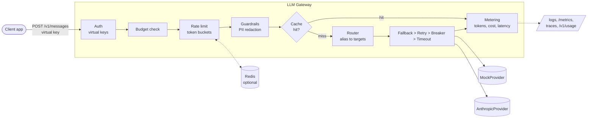
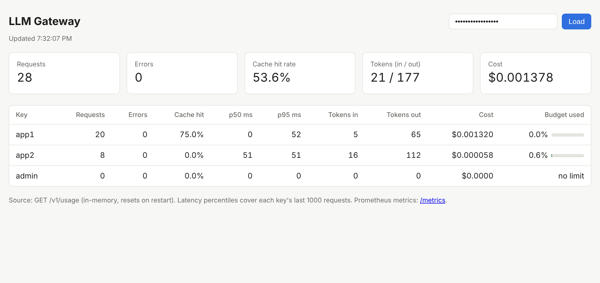

# LLM Gateway

A self-hostable gateway that sits between your apps and LLM providers. Apps call one Messages-style endpoint with a virtual API key. The gateway picks the model, retries and falls back when a provider fails, enforces per-key rate limits and budgets, caches repeat answers, redacts PII from prompts, and reports latency, errors, tokens and cost through logs, Prometheus metrics, OpenTelemetry traces and a small dashboard. It runs fully offline against a deterministic mock provider, and switches to the real Anthropic API when `ANTHROPIC_API_KEY` is set.

Built with TypeScript, Node 22 and Fastify.

## Architecture



Request flow, in order (see `src/gateway.ts`):

1. **Auth**: the virtual key in `Authorization: Bearer` or `x-api-key` is hashed and matched against configured tenants. Config stores only SHA-256 hashes (`npm run hash-key -- <secret>`).
2. **Budget**: the request's worst-case cost is reserved against the key's `budgetUsd`; if spend plus in-flight reservations plus this request could exceed it, the answer is `429 budget_exceeded`.
3. **Rate limit**: requests/min and tokens/min token buckets per key, in memory or in Redis.
4. **Guardrails**: emails and phone numbers in the prompt become `[EMAIL]` and `[PHONE]`. Optionally the same is applied to replies, including streams.
5. **Cache**: identical deterministic requests are answered from memory.
6. **Route**: the alias (`fast`, `smart`) maps to an ordered list of provider models. Each target is wrapped in timeout, circuit breaker and retry with backoff and jitter; on failure the next target is tried.
7. **Settle**: real token usage reconciles the rate limit and is priced from the price table.

## Quickstart

```bash
npm ci
```

```bash
npm run demo
```

```bash
npm run dev
```

`npm run demo` walks through every feature offline. `npm run dev` starts the gateway on port 8080 with `config/gateway.json`. Then:

```bash
curl -s localhost:8080/v1/messages -H 'x-api-key: gw-demo-key-app1' -H 'content-type: application/json' \
  -d '{"model":"fast","max_tokens":100,"messages":[{"role":"user","content":"Hello"}]}'
```

Open `http://localhost:8080/dashboard` and enter the admin key `gw-demo-key-admin`. The demo keys are `gw-demo-key-app1`, `gw-demo-key-app2` and `gw-demo-key-admin`; the config only holds their hashes.

For the full stack (gateway, Redis for shared rate limits, Jaeger for traces, Prometheus for metrics):

```bash
docker compose up --build
```

## Demo output

From `npm run demo` (mock providers; `smart` deliberately prefers a provider that always fails):

```text
=== 1. A normal request (alias 'fast' -> mock-fast) ===
200 provider=mock model=mock-fast attempts=1 cache=SKIP redactions=0
reply: This is a mock reply from mock-fast. You said: What does a gateway do?

=== 2. Streaming (SSE): events as they arrive ===
events: message_start -> content_block_start -> content_block_delta -> content_block_stop -> message_delta -> message_stop
text: This is a mock reply from mock-fast. You said: Stream please

=== 3. Cache: the same deterministic request twice ===
first:  provider=mock model=mock-fast attempts=1 cache=MISS redactions=0
second: cache=HIT redactions=0

=== 4. PII redaction before the provider sees the prompt ===
provider=mock model=mock-fast attempts=1 cache=SKIP redactions=2
the provider received: I am [EMAIL], call me on [PHONE]

=== 5. Fallback + circuit breaker ('smart' prefers a broken provider) ===
request 1: 200 provider=mock model=mock-smart attempts=3 cache=SKIP redactions=0
request 2: 200 provider=mock model=mock-smart attempts=1 cache=SKIP redactions=0
request 3: 200 provider=mock model=mock-smart attempts=1 cache=SKIP redactions=0
gateway_fallbacks_total{provider="broken",model="broken-model"} 3
gateway_circuit_breaker_state{provider="mock"} 0
gateway_circuit_breaker_state{provider="broken"} 2

=== 6. Rate limit: key 'tight' allows 2 requests per minute ===
request 1: 200
request 2: 200
request 3: 429 Key "tight" exceeded its requests per minute limit

=== 7. Budget: key 'poor' has a $0.00006 budget (each request may cost up to ~$0.00005) ===
request 1: 200
request 2: 200
request 3: 429 budget_exceeded: Key "poor" has $0.000044 left of its $0.00006 budget (including requests in flight); this request may cost up to $0.000050
```

In step 5, the first request tries the broken provider twice (retry), opens its circuit, and falls back: 3 attempts. Later requests skip the open circuit straight away: 1 attempt, no added latency.

The dashboard after some traffic:



## Load test results

`npm run loadtest` starts a fresh gateway per scenario against the mock provider (50ms upstream latency) and drives it with autocannon: 50 connections, 10 seconds each. Full output: [loadtest/results.md](loadtest/results.md).

| Scenario | Setup | Requests | Throughput (req/s) | p50 ms | p95 ms | p99 ms | Error rate |
|---|---|---:|---:|---:|---:|---:|---:|
| cache off | every request goes upstream | 9558 | 955 | 51.3 | 55.5 | 61.7 | 0% |
| cache on | 100 distinct prompts, temperature 0 | 82186 | 8210 | 5.1 | 10.5 | 14.3 | 0% |
| 10% errors, no retries | cache off, maxAttempts 1 | 9607 | 960 | 51.6 | 54.4 | 58 | 10% |
| 10% errors, retries | cache off, maxAttempts 3, backoff 25 to 250ms | 8562 | 855 | 51.1 | 114.7 | 128 | 0.12% |

Machine: 4 vCPU Intel Xeon @ 2.10GHz, Node 22, logging off.

How to read it:

- **Gateway overhead is small.** With cache off, 50 connections and a 50ms upstream allow at most 1,000 req/s. The gateway reaches 955 req/s with p50 at 51.3ms, so it adds about 1ms per request.
- **The cache moves the bottleneck from the upstream to the gateway.** With 100 distinct prompts, almost every request after the first 100 is a hit. Throughput rises about 8.6x and p50 falls about 10x. The remaining 5ms is the gateway's own CPU cost (auth, validation, hashing, JSON) under 50 concurrent connections.
- **Retries trade tail latency for reliability.** With 10% injected failures and no retries, clients see 10% errors. With up to 3 attempts, the error rate drops to 0.12% (theory: 0.1^3 = 0.1%). The cost is in the tail: about 10% of requests pay one backoff and a second upstream call, so p95 rises from 55ms to 115ms. p50 is unchanged.
- **The circuit breaker stayed closed** during the 10% error runs: 5 consecutive failures at a 10% rate are rare. It is there for outages, not for background noise.

Numbers depend on the machine; compare rows with each other rather than with other hardware.

## Design decisions and tradeoffs

Short form below. The reasoning for each is in [docs/adr](docs/adr) and [DECISIONS.md](DECISIONS.md).

- **Provider interface with a mock as default** ([ADR 0001](docs/adr/0001-provider-interface-and-mock-first.md)). Everything is testable offline. The cost: SSE is re-rendered from provider-neutral chunks, so only text content is supported.
- **Resilience order is fallback > retry > breaker > timeout** ([ADR 0002](docs/adr/0002-resilience-layering.md)). An opening breaker immediately stops retries and moves to the next target. Only retryable errors count against the breaker.
- **Streams can only be retried before the first byte.** After that, a failure is an SSE `error` event, because sent bytes cannot be taken back. The first byte is bounded by the per-attempt timeout; every later chunk by an idle timeout (`streamIdleTimeoutMs`), so a silent upstream cannot hold a connection forever. Time to first token is its own histogram.
- **Client disconnects are not upstream failures.** They cancel the upstream call, are never retried, and never count against a circuit breaker.
- **Rate limits check an estimate, then reconcile** ([ADR 0003](docs/adr/0003-token-bucket-rate-limits.md)). Exact real token counts are only known after the call. The bucket can go negative, which keeps the long-run rate correct.
- **The Redis store runs the token bucket in Lua** for atomicity across instances, with Redis `TIME` as the shared clock.
- **The cache is exact-match, per tenant, temperature 0 only** ([ADR 0004](docs/adr/0004-exact-match-cache.md)). Safe by default; lower hit rate than a shared or semantic cache.
- **Budgets reserve the worst case.** Each request reserves (estimated input + `max_tokens`) at the priciest model its alias may use, and swaps the reservation for the real cost when it finishes. Concurrent requests can never overshoot the budget together; the price is that a key near its limit is refused slightly earlier than strictly necessary.
- **One summary log line per request; Prometheus counters; OTel spans per attempt** ([ADR 0005](docs/adr/0005-observability.md)).
- **Small surface on purpose.** Text-only messages, config-file keys, in-memory usage. Each is listed below as a limitation, not hidden.

## Limitations

- Text-only messages. No tool use, images or documents; the stream chunk model carries text only.
- Virtual keys live in the config file (as SHA-256 hashes in the default config). There is no key management API; adding or revoking a key means editing config and restarting.
- Usage, budgets, cache and circuit breakers are in memory and per process. Only rate limits can be shared, via Redis. A restart resets spend, so budgets are not durable.
- If Redis is unreachable, rate limits fail open (requests are allowed and a warning is logged).
- Streams cut off midway are metered from an estimate of the text already sent, not from provider-reported usage.
- PII redaction is regex-based: emails and 10 to 15 digit phone numbers only. It misses names, addresses and unusual formats. Redacting replies (`piiRedactionOutput`) is opt-in; on streams it releases text a word at a time.
- Token estimates before the call use 4 characters per token. Real counts come from the provider afterwards.
- `temperature` is used for cache decisions but not forwarded to Anthropic, because current Claude models reject sampling parameters.
- `/metrics` and `/dashboard` are unauthenticated (the dashboard's data endpoint needs an admin key).
- The Docker image was built and smoke-tested in CI only; the development sandbox could not pull base images.

## What I'd do next

1. Move the response cache and usage ledger to Redis, so several instances share them and spend survives restarts.
2. Add latency-aware routing: prefer the target with the best recent p95 among healthy ones.

## Project layout

```text
src/
  server.ts            process entry: config, providers, Redis, listen
  app.ts               HTTP layer: auth, routes, SSE rendering, logs, metrics endpoint
  gateway.ts           the request pipeline, step by step
  router.ts            alias to targets, fallback, retry, breaker, timeout
  resilience/          retry.ts, circuit-breaker.ts, timeout.ts
  rate-limit/          token-bucket.ts (pure math), store.ts, redis-store.ts, limiter.ts
  cache.ts             cache policy, normalised key, TTL + LRU store
  metering.ts          prices, usage ledger, percentiles
  guardrails/          guardrail.ts (interface), pii.ts, stream.ts (chunk-safe output guard)
  providers/           provider.ts (interface), mock.ts, anthropic.ts
  telemetry/           metrics.ts (Prometheus), tracing.ts (OpenTelemetry)
public/dashboard.html  static dashboard
scripts/               demo.ts, loadtest.ts
test/                  unit and integration tests (vitest)
config/gateway.json    demo keys, routes, prices, limits
```

## Commands

| Command | What it does |
|---|---|
| `npm run dev` | Start the gateway with reload on change |
| `npm run demo` | Offline feature tour |
| `npm test` | Unit and integration tests (Redis tests run when `REDIS_URL` is set) |
| `npm run lint` / `npm run typecheck` | ESLint / TypeScript |
| `npm run loadtest` | Regenerate `loadtest/results.md` |
| `npm run hash-key -- <secret>` | Print the `keyHash` to put in config for a new virtual key |
| `npm run build && npm start` | Compile and run from `dist/` |

See [LEARNING.md](LEARNING.md) for a guided study of the code.

## License

MIT
